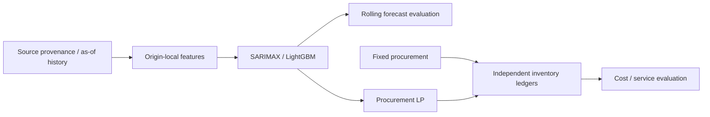

# Food Commodity Procurement Intelligence

**원재료 가격예측을 구매 LP와 재고 시뮬레이션에 연결하고, 정확도 개선이 비용·서비스 개선으로 이어지는지 검증한 데이터 사이언스 포트폴리오입니다.**

밀 구매에는 가격뿐 아니라 공급업체별 납기·발주용량·재고·부족비용이 중요합니다. World Bank Wheat US HRW 예측으로 정기 고정 구매와 Forecast-Aware 구매를 같은 운영조건에서 비교했습니다.

**Portfolio MVP: 5/5 PASS. 실제 Final Holdout: 미평가·잠금.** Private Release의 실제 실행 결과는 [Release 상태](docs/PRIVATE_RELEASE_STATUS.md)에 기록합니다.

## 핵심 결과

2021-06~2024-05의 **36개 Rolling Origin × 3 Horizon = 모델별108개 예측**입니다. 공통 target은2021-07~2024-08의38개월이며 독립인108개월이 아닙니다.

| 예측 모델 | Validation MAE (USD/t) |
|---|---:|
| Seasonal Naive | 100.0296 |
| SARIMAX | **41.8757** |
| LightGBM Direct | 48.6620 |

| 대표 구매 정책 | Total Simulated Cost (USD) | Fill Rate | Unmet Demand |
|---|---:|---:|---:|
| Fixed | **1,351,501.68** | **100%** | **0t** |
| Forecast-Aware SARIMAX | 1,365,914.16 | 99.4737% | 20t |

SARIMAX MAE는 기준보다58.14% 낮았지만 FA 비용은 **14,412.48 USD(+1.0664%) 높았습니다.** 매입·보관비 감소를 부족비용이 초과했습니다. **예측 정확도 개선이 구매비용 절감으로 자동 연결되지 않으며, 납기·재고·Runoff 제약과 서비스 비용을 함께 평가해야 합니다.**

이는 **실제 Validation 가격 + 가상 수요·업체·운영조건**의 결과입니다. 기업 절감 실적·인과효과·독립 Holdout 성능이 아닙니다. [집계 Evidence와 해석](docs/PORTFOLIO_RESULTS.md) · [집계 JSON](evidence/portfolio_summary.json).

## 데이터와 정보 시점

- 공식 World Bank Pink Sheet, `Wheat, US HRW`, nominal USD/metric tonne. 원천 가격파일은 Git에 없습니다.
- 월말 t에는 **관측월≤t−1, available_at≤decision_at**인 자료만 사용합니다. 납품 t+1/t+2/t+3은 최신 관측 기준2/3/4개월 앞입니다.
- 과거 origin o의 완전 다중 Horizon 학습은 **o+3≤t−1**와 전체 공표 조건을 만족해야 합니다. 특징·전처리·잔차·보정도 as-of 경계를 따릅니다.
- 단일 수정 Snapshot과 가정 공표지연을 사용하는 **pseudo-real-time** 평가입니다. 과거 vintage·최초 공표시각은 미검증이며2020-07 HRW 정의 경계도 보존합니다.

[공식 출처·버전·이용조건](docs/WORLD_BANK_SOURCE.md) · [시점 계약](docs/DECISION_TIMELINE.md) · [분할 설계](docs/SPLIT_DESIGN.md)

## 구현 구조



`src/food_procurement_intelligence/`의 data/features/forecasting/uncertainty/optimization/policies/simulation/evaluation이 각 단계를 담당합니다. LP는 현재 주문만 확정하고 미래 계획은 재최적화합니다. 납기·용량·기존 pipeline·수령월 비용·Runoff·말기 단회계상을 검증합니다.

확장에는 추가5정책, OOF 공동128경로와 CVaR(α=.90, λ=0/.50),11개 운영조건 민감도가 있습니다. **Day9/10 실제 Validation 가격 기반 가상 운영평가**와 **Day12~17 합성 Native/Legacy 통합 검증**은 별개입니다. 합성 통과는 실제 Source/Seed Runtime 검증을 뜻하지 않습니다.

## 실행과 검증

Python3.11을 사용합니다. 다음은 새 환경 설치 계약이며 실제 가격 다운로드는 없습니다.

```sh
python -m venv .venv
# 생성한 환경의 Python을 활성화한 뒤 실행
python -m pip install -r requirements/day7-lock.txt
python -m pip install pytest==8.3.5
python -m pip install --no-deps -e .
python scripts/ci/run_contract_tests.py
python scripts/release/audit.py
```

- **A/B 저장소만으로 재현:** toy parser·as-of·모델 계약·합성 LP/회계·누수 테스트. 실제 가격·로컬 Evidence·Secret을 사용하지 않습니다.
- **C 실제 원천 필요:** 추출/예측에는 별도 원천·manifest·명시 접근 승인이 필요합니다. Release는 원천을 조회하지 않습니다.
- **D 로컬 Evidence 필요:** 과거 전체613개 테스트와 archive hash 재현은 Git에서 제외한 로컬 archive가 필요합니다. 전체 `pytest`를 무조건 CI로 실행하지 않습니다.

CI는 `configs/ci.toml`의 범위만 검증합니다. 과거613 passed를 원격 CI 결과로 표시하지 않습니다. [정확한 재현 범위와 환경](docs/RELEASE_REPRODUCIBILITY.md)을 확인하세요.

## 한계와 종료 범위

낮은 구간 Coverage, 경험적 시나리오 확률, 단일 시장경로·원재료, 가상 비용·수요·납기, Runoff·말기 근사와 Validation 선택편향이 남습니다.

**Day18 ACCESS_APPROVAL_REQUIRED 유지.** 실제 Source Export·Seed Runtime은 미검증이며 Bridge/Holdout 접근·학습·평가·Unlock은 비활성입니다.

[후속 Backlog](ROADMAP.md) · [향후 Public 전환 체크리스트](docs/PUBLIC_RELEASE_CHECKLIST.md). **이번에는 Public 전환을 하지 않으며 코드 라이선스는 소유자 선택 전까지 미지정입니다.** 데이터 이용조건은 코드 라이선스와 별개입니다.
