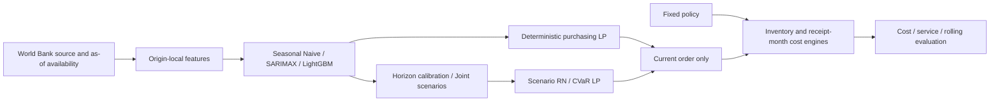

# Food Commodity Procurement Intelligence

**A leakage-aware forecasting and procurement decision system that connects monthly wheat prices to purchasing plans, inventory flows, cost and service outcomes.**

Procurement teams must balance price with supplier lead times, capacity, stock and shortage penalties. This project tests whether better price forecasts improve those decisions under the same operating conditions.

**Portfolio MVP: 5/5 accepted. Actual Final Holdout: unevaluated and locked. Actual Source/Seed Runtime: NOT_VERIFIED.**

## Solution overview

Forecast three delivery months, plan supplier orders, execute only the current order and reoptimize next month. Compare Fixed, Forecast-Aware, Risk-Neutral and CVaR Risk-Aware policies with identical external paths and independent inventory states. Preserve forecast/decision/receipt/cost provenance and fail explicitly when inputs or solutions are invalid.



## Core capabilities

- Literal World Bank workbook parsing, schema/unit checks, snapshot provenance and restricted-source validation.
- As-of feature engineering, mature-label TrainingBatch, rolling forecasts and immutable Native/Legacy evidence contracts.
- Horizon-wise rolling interval calibration and complete-vector OOF Joint bootstrap: recent60/minimum24,128paths.
- Supplier/capacity/lead-time purchasing LPs, shared-scenario RN/RA decisions, independent inventory accounting and terminal/Runoff checks.
- Seven-policy evaluation, operational sensitivity, explicit solver/failure states and independent saved-result verification.

The domain packages are data, features, forecasting, uncertainty, optimization, policies, simulation and evaluation under `src/food_procurement_intelligence/`. Named specifications are in `configs/data`, `forecasting`, `scenarios`, `procurement` and `evaluation`.

## Data and evaluation design

The benchmark is World Bank Pink Sheet **Wheat US HRW, nominal USD/metric tonne**. At month-end t, use observation months≤t−1 and publication timestamps≤decision time. Delivery H1/H2/H3 target t+1/t+2/t+3: steps2/3/4 from the latest observation. Complete training vectors require o+3≤t−1 plus all publication conditions.

Validation covers36origins(2021-06..2024-05),108origin-horizon predictions/model and38unique target months(2021-07..2024-08). Targets overlap. Actual prices come from one revised Snapshot with assumed publication lag: **pseudo-real-time**, without verified historical vintages. Raw/processed/approved price data and large execution archives are excluded from Git.

## Key results

| Forecast model | Validation MAE (USD/t) | Fold-as-of MASE |
|---|---:|---:|
| Seasonal Naive |100.0296|3.2300|
| SARIMAX |**41.8757**|**1.3624**|
| LightGBM Direct |48.6620|1.5912|

| Representative policy | Total Simulated Cost (USD) | Fill Rate | Shortage |
|---|---:|---:|---:|
| Fixed |**1,351,501.68**|**100%**|**0t**|
| Forecast-Aware SARIMAX |1,365,914.16|99.4737%|20t|

SARIMAX reduced forecast MAE by58.14%, but its FA procurement policy cost **14,412.48USD(+1.0664%) more**. Lower purchase/holding costs were outweighed by shortage cost and Runoff constraints.

**Better price forecasting does not automatically translate into lower procurement costs.** Evaluate lead times, stock, capacity, terminal conditions and service penalties alongside accuracy.

These are **real Validation prices with synthetic purchasing operations**, not corporate savings, causal effects or independent Holdout performance. The five additional policies, CVaR and11operational sensitivity cells are documented as extensions in [Validation results](docs/VALIDATION_RESULTS.md). Separate synthetic Native/Legacy qualification does not verify actual market-source Runtime.

## Quick start and reproducibility

Use Python3.11 and an activated virtual environment:

```sh
python -m venv .venv
# Activate the generated environment using your shell's standard activation command.
python -m pip install -r requirements/runtime-lock.txt
python -m pip install pytest==8.3.5
python -m pip install --no-deps -e .
python scripts/ci/run_contract_tests.py
python scripts/validation/run_synthetic_checks.py
python scripts/release/audit.py
```

The first check preserves **all330previous clean-checkout contract cases**. The second reruns **six existing synthetic integration cases**: seven-policy engine/LP execution, shared scenarios, future-information invariance, lambda boundaries and non-anticipativity. The six are a subset of330, not new market experiments. Neither command reads source prices or excluded local Evidence; test network connections are blocked. CI also verifies both entrypoints.

Historical613passed refers to an excluded local archive suite. Replaying original source/forecast/evidence runs requires separately prepared, approved data and recorded artifacts. Do not run the entire archive-dependent suite expecting a bare clone to contain those inputs. See [Reproducibility](docs/REPRODUCIBILITY.md) for environment, installation, scopes and historical freeze boundaries.

## Limits and current status

Interval Coverage was below nominal80%. Joint probabilities are empirical, operations are synthetic and results depend on one commodity/history, revisions, Validation selection, fixed planning horizon and Runoff/terminal assumptions. [Limitations](docs/LIMITATIONS_AND_FUTURE_WORK.md) remain explicit.

**ACCESS_APPROVAL_REQUIRED remains in force.** Actual Source Export/Seed Runtime is unverified; actual Bridge/Holdout reading, fit, policy evaluation and unlock are disabled. This release consolidates software and documentation without new models, tuning, market experiments or dashboards. The repository stays PRIVATE; the owner has not selected a code license.

## Technical documentation

| Topic | Guide |
|---|---|
| Purpose, inputs/outputs and APIs | [Product overview](docs/PRODUCT_OVERVIEW.md) |
| Pipeline and ownership boundaries | [System architecture](docs/SYSTEM_ARCHITECTURE.md) |
| Source, temporal access and Legacy evidence | [Data and as-of contract](docs/DATA_AND_ASOF_CONTRACT.md) |
| Features, model specs and backtesting | [Forecasting method](docs/FORECASTING_METHOD.md) |
| Validity, calibration and Joint maturity | [Uncertainty and scenarios](docs/UNCERTAINTY_AND_SCENARIOS.md) |
| LPs, CVaR and inventory accounting | [Procurement optimization](docs/PROCUREMENT_OPTIMIZATION.md) |
| Forecast, seven-policy and sensitivity results | [Validation results](docs/VALIDATION_RESULTS.md) |
| Safe execution and archive reproduction | [Reproducibility](docs/REPRODUCIBILITY.md) |
| Old/new file and evidence mapping | [Migration and evidence](docs/MIGRATION_AND_EVIDENCE.md) |

Future source qualification, separately approved final research evaluation and external validity studies are [independent backlog items](ROADMAP.md). Any owner-led Public transition must first satisfy the [Public release checklist](docs/PUBLIC_RELEASE_CHECKLIST.md).
