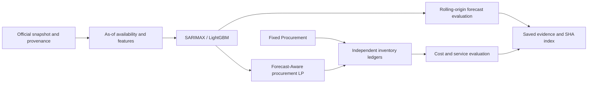

# Architecture Overview

`data/acquisition.py`·`world_bank.py`은 원본 수집/추출, `availability.py`와 `features/price.py`는 공표시각·as-of 특징/성숙 label을 담당합니다. 예측 함수에는 평가용 실제값 reader를 전달하지 않습니다. `forecasting/`과 `evaluation/model_backtesting.py`는 동일36개 origin의108개 예측과 fold별 scale/provenance를 저장했습니다.

`policies/fixed.py`와 `forecast_aware.py`의 주 비교는 같은 초기상태와 외생가격·수요·납기 환경을 사용합니다. `optimization/deterministic.py`와 calendar adapter는3개월 미래 계획을 만들지만 현재 q만 실행합니다. `simulation/engine.py`가 입고·재고·부족·비용을 갱신하고 evaluator만 미래 실현 경로를 읽습니다. 최종 실제 말기비와 계획의 말기 근사를 구분합니다.

확장은 `uncertainty/`, `scenario_lp.py`, `risk_aware.py`의 raw quantile/OOF/공동bootstrap/CVaR입니다. 7정책 계약은 유지하며 주 MVP2정책과 구분합니다. Day12 `sequential.py`·`publisher.py`·`sequential_runner.py`는 합성 source/native 연결을 검증했고 실제 source capability는 비활성입니다.

Day13 스크립트는 위 실행 경로를 호출하지 않습니다. 기존 artifact의 hash→CSV/JSON 재계산→비용/재고 정합성→Acceptance→Evidence Release로 끝납니다. 원천 디렉터리 전체 open을 차단합니다. 시나리오 UI·대시보드·새 모델·새 실험은 없습니다. 이 Python/API 경계는 OS 보안 격리를 의미하지 않습니다.
