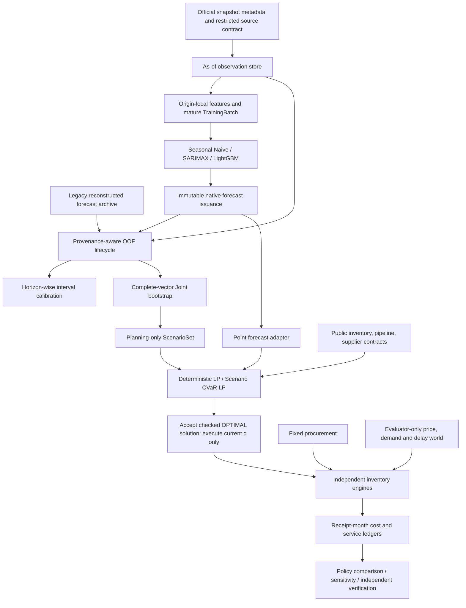

# System architecture

## Boundaries and ownership

`data/_xlsx.py` reads literal workbook ZIP/XML; `world_bank.py` validates the observed schema, units and provenance. `availability.py` is the locked development API; `sequential.py` provides session-scoped synthetic publication. The pure restricted export validator accepts bytes obtained under a separate authority and never issues a real permission.

The feature layer derives every lag/window from origin-local history. A TrainingBatch includes past-origin features and fully mature labels, not an evaluator reader. `model_backtesting.py` generates forecasts before validation labels are accessed for scoring. `publisher.py` records model/feature/source/session/fit provenance and immutable issuance digests.

`HorizonSequentialOOF` inherits the existing Joint arithmetic while releasing each horizon's calibration independently. The older full-vector calibration lifecycle remains an explicitly distinct compatibility contract in `uncertainty/sequential.py`; it is not silently merged into the corrected lifecycle. `ProvenanceSequentialOOF` dispatches Legacy and current-run Native evidence by actual type.

Point and scenario adapters restrict origin/model/purpose. The policy receives public state and forecasts, while the evaluator owns the realized world. RN and RA for the same model share one immutable Planning scenario set. Each of seven policies has independent inventory and pipeline state.

The simulation engine alone knows actual arrival delays, realized demand and settlement prices. It does not expose current settlement unit costs that reveal an unpublished index. Runoff stops new orders/provider calls; global terminal cost is counted once.

## Evaluation responsibilities

| Module | Responsibility |
|---|---|
| `backtesting`, `model_backtesting`, `model_comparison` | rolling forecasts, fold scales, completeness and error metrics |
| `scenario_diagnostics` | saved-OOF Joint diagnostics and explicit Fixed toy arithmetic |
| `deterministic_backtest`, `scenario_backtest` | distinct deterministic and scenario-planner evaluation contracts |
| `historical_backtest`, `policy_backtest`, `policy_inputs` | equal-world policy evaluation, current-order execution, failure/prefix reporting |
| `sensitivity`, `sensitivity_runner` | baseline-gated OAT/stress diagnostics, unsupported assumptions explicit |
| `preflight_runner`, `synthetic_preflight`, `native_integration` | synthetic qualification; historical freeze prerequisites are separate |
| `final_contract`, `release_gate`, `readiness` | frozen calendar, independent readiness gates, actual execution disabled |

The consolidation moves orchestration; it does not rewrite forecast estimators, optimization formulations, RNG draw rules or engine arithmetic. `scripts/compatibility/` preserves archived audit/freeze/replay contracts with explicit historical evidence requirements. No current command treats their old path-based Candidates as a new release approval.

## Provenance and failure

Experiments preserve configuration copies, Python/package versions, code/source hashes, split boundaries, seed and scenario IDs. Fit/interval/pool/source/solver/accounting failures are distinct. Failed policies are not compared using a favorable partial interval; missing ledgers are not fabricated. Source/API guards are Python programming boundaries, not OS security isolation.
