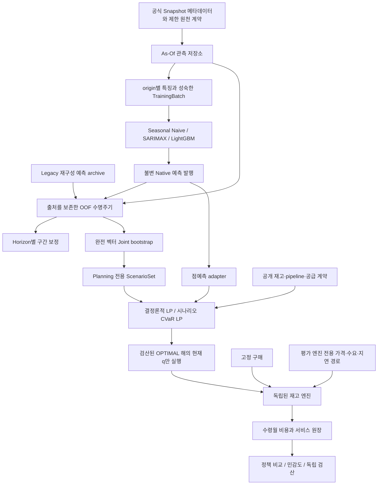

# 시스템 아키텍처

## 정보 경계와 소유 주체

`data/_xlsx.py`는 워크북 ZIP/XML의 literal 값을 읽습니다. `world_bank.py`는 확인된 스키마·단위·출처를 검사합니다. `availability.py`는 잠긴 개발 API, `sequential.py`는 세션별 합성 공표를 담당합니다. 순수 제한 Export validator는 별도 권한으로 확보한 bytes만 검사하며 실제 접근 승인을 발급하지 않습니다.

특징 계층은 각 origin에서 공개된 이력으로만 lag·rolling을 계산합니다. TrainingBatch에는 과거 origin 특징과 완전히 성숙한 label을 넣고 평가용 정답 reader를 전달하지 않습니다. `model_backtesting.py`는 예측을 만든 뒤 Validation 정답을 채점에 사용합니다. `publisher.py`는 모델·특징·원천·세션·학습 증거와 불변 발행 digest를 기록합니다.

`HorizonSequentialOOF`는 기존 Joint 수식을 재사용하면서 보정 잔차는 Horizon별로 공개합니다. 이전 완전 벡터 보정은 `uncertainty/sequential.py`의 별도 호환 계약으로 유지합니다. `ProvenanceSequentialOOF`는 실제 타입에 따라 Legacy와 현재 실행 Native 증거를 검증합니다.

점예측·시나리오 adapter는 origin·모델·purpose를 제한합니다. 정책은 공개 상태와 예측만 받고, 평가 엔진은 실현 경로를 소유합니다. 같은 모델의 RN/RA는 불변 Planning 세트를 공유하지만, 7개 정책의 재고·pipeline 상태는 각각 독립적입니다.

시뮬레이션 엔진만 실제 도착 지연·실현 수요·정산 가격을 압니다. 미공표 지수를 역산할 수 있는 현재 정산 단가를 정책에 노출하지 않습니다. Runoff에는 신규 발주와 provider 호출을 멈추고 전체 기간의 말기비용을 한 번만 계상합니다.

## 평가 모듈의 책임

| 모듈 | 책임 |
|---|---|
| `backtesting`, `model_backtesting`, `model_comparison` | 순차 예측, fold별 scale, 완전성과 오차 지표 |
| `scenario_diagnostics` | 저장 OOF Joint 진단과 명시적 Fixed Toy 산술 |
| `deterministic_backtest`, `scenario_backtest` | 서로 다른 결정론적·시나리오 계획 평가 계약 |
| `historical_backtest`, `policy_backtest`, `policy_inputs` | 동일 외생 경로 비교, 현재 주문 실행, 실패·확인 가능 prefix 기록 |
| `sensitivity`, `sensitivity_runner` | 기준선 회귀를 선행하는 OAT·stress 진단, 미지원 가정 표시 |
| `preflight_runner`, `synthetic_preflight`, `native_integration` | 합성 통합 검증, 별도 역사적 Freeze 요건 |
| `final_contract`, `release_gate`, `readiness` | 고정 달력·독립 준비도 Gate, 실제 실행 비활성 |

도메인별 구현을 재사용하며 예측기·최적화 수식·RNG 추출 규칙·재고 산술은 유지합니다. `scripts/compatibility/`의 과거 감사·Freeze·재현 도구는 해당 코드 버전과 제외된 Evidence를 필요로 합니다. 과거 경로 기반 Candidate를 현재 실행 승인으로 바꾸지 않습니다.

## 출처 추적과 실패 처리

실험 기록은 설정 사본, Python·패키지 버전, 코드·원천 해시, 분할 경계, seed와 시나리오 ID를 연결합니다. 학습 실패·구간 무효·pool 부족·원천 미검증·solver 실패·회계 실패를 구분합니다. 유리한 일부 기간만 골라 실패 정책을 비교하거나 없는 원장을 만들지 않습니다. 이러한 Python/API 경계는 OS 보안 격리와는 구분됩니다.
