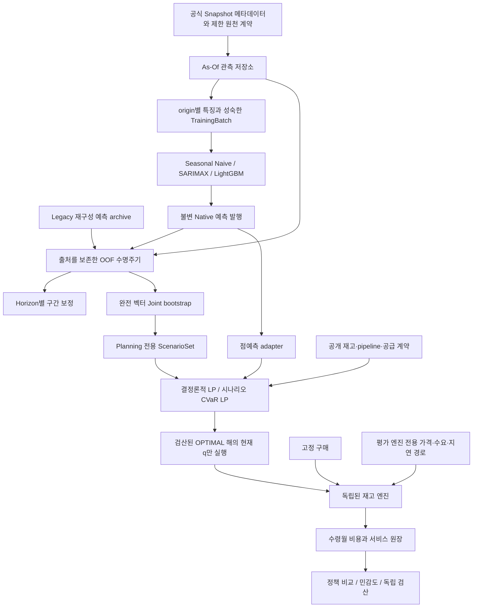

# 시스템 아키텍처

한 번의 월말 결정을 기준으로 보면 흐름이 두 갈래입니다. 의사결정 쪽은 그날 공개된 가격과 주문 상태로 현재 발주량을 계산합니다. 평가 쪽은 같은 외부 경로를 모든 정책에 적용해 입고, 비용, 부족을 기록합니다. 이 둘을 분리하면 나중에 알게 된 가격이나 지연이 발주 입력으로 섞이는 경로를 줄이고, 결과 차이가 예측·주문·회계 중 어느 단계에서 생겼는지 추적할 수 있습니다.

## 월말 한 번의 결정에서 각 단계가 받는 정보

가격 행을 받는 곳과 가격을 볼 수 있는 곳을 구분했습니다. `data/_xlsx.py`는 워크북 ZIP/XML의 literal 값을 읽고 `world_bank.py`는 스키마·단위·출처를 검사합니다. 개발 API의 날짜·접근 제한은 `availability.py`에, 세션별 합성 공표는 `sequential.py`에 있습니다. 제한 Export validator가 판단하는 범위는 별도 권한으로 확보한 bytes의 계약 적합성까지입니다.

같은 과거 사례라도 어떤 날의 이력으로 특징을 만들었는지가 중요합니다. 특징 계층은 각 origin에서 공개된 이력으로 lag·rolling을 계산합니다. TrainingBatch는 그때의 특징과 현재 학습 시점에 세 달 모두 공개된 label을 묶습니다. 평가용 정답 reader는 `model_backtesting.py`의 채점 경계에 두고 예측 생성 뒤에 사용합니다. `publisher.py`의 불변 발행 digest로 모델·특징·원천·세션·학습 증거를 예측과 연결합니다.

`HorizonSequentialOOF`는 기존 Joint 수식을 재사용하면서 보정 잔차는 Horizon별로 공개합니다. 이전 완전 벡터 보정은 `uncertainty/sequential.py`의 별도 호환 계약으로 유지합니다. `ProvenanceSequentialOOF`는 실제 타입에 따라 Legacy와 현재 실행 Native 증거를 검증합니다.

점예측·시나리오 adapter는 origin·모델·purpose가 맞는 입력만 정책에 넘깁니다. 같은 모델의 RN/RA에 동일한 불변 Planning 세트를 주면 비용 목적의 차이를 비교할 수 있습니다. 주문이 달라지면 이후 재고도 달라지므로 7개 정책의 재고와 pipeline은 따로 관리합니다.

현재 정산 단가만 건네도 미공표 지수를 역산할 수 있습니다. 그래서 도착 지연·실현 수요·정산 가격은 시뮬레이션 엔진이 소유하고 정책에는 공개 상태만 전달합니다. 마지막 결정 뒤 Runoff에서는 기존 주문을 정산하는 데 집중합니다. 신규 발주와 provider 호출을 멈추고 말기비용은 전체 기간 끝에 한 번 계상합니다.

## 평가 모듈의 책임

| 모듈 | 책임 |
|---|---|
| `backtesting`, `model_backtesting`, `model_comparison` | 순차 예측, fold별 scale, 완전성과 오차 지표 |
| `scenario_diagnostics` | 저장 OOF Joint 진단과 명시적 Fixed Toy 산술 |
| `deterministic_backtest`, `scenario_backtest` | 서로 다른 결정론적·시나리오 계획 평가 계약 |
| `historical_backtest`, `policy_backtest`, `policy_inputs` | 동일 외생 경로 비교, 현재 주문 실행, 실패·확인 가능 prefix 기록 |
| `sensitivity`, `sensitivity_runner` | 기준선 회귀를 선행하는 OAT·stress 진단, 미지원 가정 표시 |
| `preflight_runner`, `synthetic_preflight`, `native_integration` | 합성 통합 검증, 별도 역사적 Freeze 요건 |
| `final_contract`, `release_gate`, `readiness` | 고정 달력·독립 준비도 Gate, 실제 실행 비활성 |

결정론적 평가와 시나리오 평가는 같은 도메인 구현을 호출합니다. 평가 경로가 달라도 예측기·최적화 수식·RNG 추출 규칙·재고 산술의 기준은 같습니다. `scripts/compatibility/`의 감사·Freeze·재현 도구는 당시의 코드 버전과 제외된 Evidence를 필요로 합니다. 과거 경로 기반 Candidate의 용도는 역사적 검증입니다.

## 출처 추적과 실패 처리

실험 기록은 설정 사본, Python·패키지 버전, 코드·원천 해시, 분할 경계, seed와 시나리오 ID를 연결합니다. 학습 실패·구간 무효·pool 부족·원천 미검증·solver 실패·회계 실패를 구분합니다. 유리한 일부 기간만 골라 실패 정책을 비교하거나 없는 원장을 만들지 않습니다. 이러한 Python/API 경계는 OS 보안 격리와는 구분됩니다.
